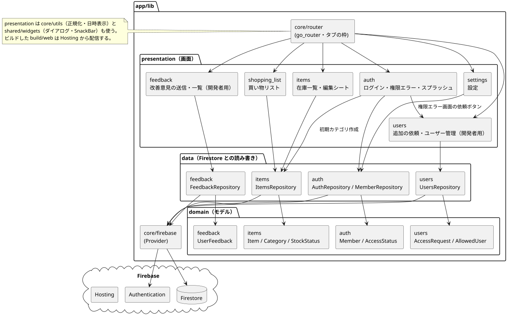
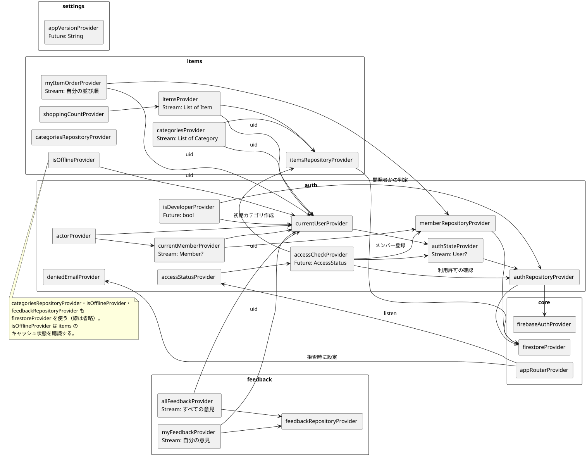

# 層と Provider

## 1. 3 層と依存の向き

| 層 | 役割 | 主なファイル |
|---|---|---|
| `domain/` | アプリの概念。Flutter・Firebase に依存しない | `Member`, `AccessStatus`, `StockStatus`, `Category`, `Item`, `Purchase`, `ClaimResult`、並び順の関数（`item_order.dart`）、カテゴリ名の入力チェック（`category_name_rules.dart`） |
| `data/` | Firestore・Authentication との読み書き。Firestore のデータと domain のクラスを相互に変換する | `AuthRepository`, `MemberRepository`, `ItemsRepository`, `CategoriesRepository` |
| `presentation/` | 画面・ウィジェット・Riverpod の Provider | 各画面、`auth_providers.dart`, `items_providers.dart`, `connectivity_provider.dart` |

- 依存の向きは `presentation → domain ← data`。画面は Repository を Provider 経由で使う。
- `core/` はアプリ全体の土台（Firebase の Provider、画面遷移、テーマ、汎用の関数）。`shared/widgets/` は複数の機能で使うダイアログなど。

### 機能をまたぐ依存

| 依存元 | 依存先 | 理由 |
|---|---|---|
| `auth/presentation/auth_providers.dart` | `items/data/items_repository.dart` | 利用開始の準備で、初期カテゴリを作るため |
| `shopping_list/` | `items/` の data・domain・presentation | 買い物リストは items のデータを別の切り口で表示する画面のため、独自の data・domain を持たない |
| `items/presentation/items_providers.dart` | `auth/data/member_repository.dart` | 自分の並び順（`users.itemOrder`）を読むため |
| `settings/` | `auth/` の data・presentation | 表示名の変更・ログアウト |
| `settings/` | `items/` の data・domain・presentation | カテゴリ管理画面（カテゴリの読み書き・カテゴリ名の入力チェック） |
| `core/router/` | 各機能の画面、`auth_providers.dart` | 画面遷移の定義と遷移先の判定 |

## 2. 全体像

元データ: [components.puml](diagrams/components.puml)

## 3. Provider 一覧

| Provider | 種類 | 内容 |
|---|---|---|
| `firebaseAuthProvider` / `firestoreProvider` | Provider | Firebase の各サービス（テストで差し替えられるよう Provider 経由で使う） |
| `authRepositoryProvider` / `memberRepositoryProvider` / `itemsRepositoryProvider` / `categoriesRepositoryProvider` | Provider | Repository |
| `authStateProvider` | StreamProvider | ログイン状態（`User?`） |
| `currentUserProvider` | Provider | ログイン中のユーザー（未ログイン・確認中は null） |
| `accessCheckProvider` | FutureProvider | 利用許可の確認と、利用開始の準備（メンバー登録・初期カテゴリ作成）。結果は `AccessStatus` |
| `accessStatusProvider` | Provider | 画面の出し分けに使う判定結果。読み込み中は `checking`、エラーは `error` |
| `deniedEmailProvider` | NotifierProvider | 利用を許可されなかったメールアドレス（アクセス権限エラー画面に表示する） |
| `currentMemberProvider` | StreamProvider | 自分の `users` ドキュメント（表示名） |
| `actorProvider` | Provider | 更新者・担当者として記録する自分（uid と表示名）。表示名がまだ読めていなければ Google アカウントの名前を使う |
| `categoriesProvider` | StreamProvider | カテゴリ一覧（`order` 順） |
| `itemsProvider` | StreamProvider | アイテム一覧（並び順は画面側で決める） |
| `shoppingCountProvider` | Provider | 買い物リストに出ている件数（タブのバッジ） |
| `myItemOrderProvider` | StreamProvider | 自分の並び順（カテゴリ ID → アイテム ID の配列）。`users/{自分の uid}.itemOrder` を購読する |
| `isOfflineProvider` | NotifierProvider | オフライン表示を出すか。items を 1 件だけ購読し、データがキャッシュから来ている状態が 3 秒続いたら true（[ADR 0008](../decisions/0008_offline_from_cache_state.md)） |
| `appVersionProvider` | FutureProvider | アプリのバージョン（`package_info_plus` の `version+buildNumber`）。設定画面に表示する |
| `appRouterProvider` | Provider | `GoRouter`。`accessStatusProvider` を監視して画面を切り替える |

元データ: [providers.puml](diagrams/providers.puml)

### サインアウト時の購読の停止

`categoriesProvider`・`itemsProvider`・`myItemOrderProvider`・オフライン判定の購読は、ログイン中の uid を監視する。uid が null（サインアウト）になると空のリストを返す Stream に切り替わり、Firestore の購読をやめる。

## 4. Firebase の使い方

| サービス | 使い方 |
|---|---|
| Authentication | Google ログインのみ（ポップアップ方式。[ADR 0004](../decisions/0004_login_with_popup.md)） |
| Firestore | すべてのデータを保存する。画面は `snapshots()` を購読し、他の家族の変更をリアルタイムに反映する |
| Hosting | `flutter build web` で作った静的ファイル（build/web）を配信する。`html` / `js` / `json` は `no-cache` にして、更新がすぐ届くようにする |

- Spark（無料）プランで運用し、Cloud Functions は使わない（[ADR 0001](../decisions/0001_no_cloud_functions.md)）。サーバー側の処理はなく、データの整合はアプリ側のトランザクション・バッチと Firestore のセキュリティルールで保つ。
- 起動時（`main.dart`）に Firestore のオフライン永続化を有効にしている（`persistenceEnabled: true`、複数タブ対応の `WebPersistentMultipleTabManager`）。電波が弱い場所でも、最後に取得した内容を表示・操作できる。
  - オフライン中は、画面上部に「オフラインです。変更は接続が戻ると反映されます」と表示する（`isOfflineProvider`、`HomeShell`）。
  - トランザクション（担当宣言など）はオフラインでは失敗し、「保存できませんでした」と表示する。
- 設定値（apiKey など）は `--dart-define-from-file` でビルド時に渡す（[folder_structure.md](folder_structure.md) の「設定値（秘密情報）の扱い」）。
- アクセス制限の詳細はリポジトリでは管理しない。
