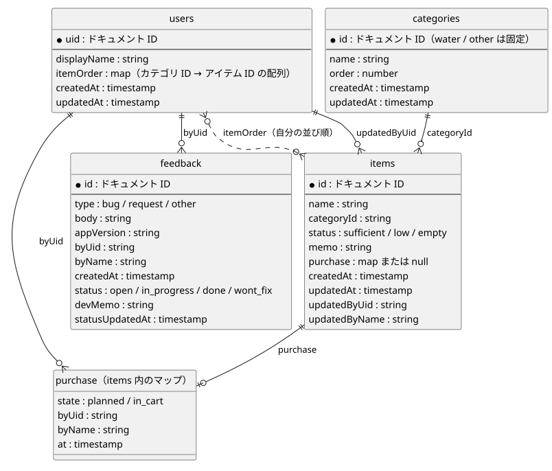

# データ (data)

- [Firestore のデータモデル](firestore_model.md) … コレクションとクラスの対応、変換、書き込みの単位、トランザクション・バッチ

フィールドの定義（型・必須・文字数）は仕様の [spec/02_data.md](../../spec/02_data.md) を正とし、ここでは実装上の扱いを書く。

元データ: [er.puml](diagrams/er.puml)
