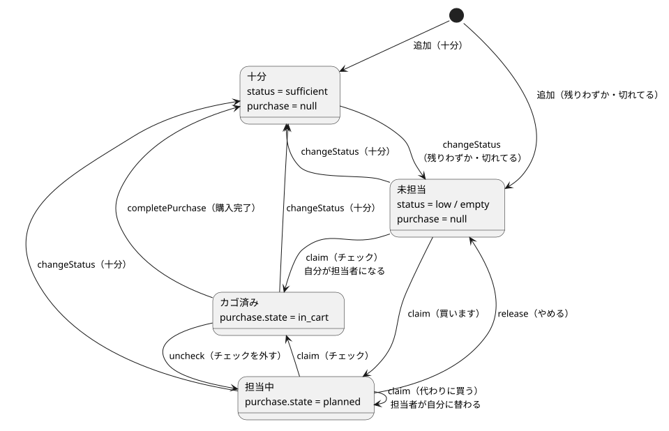

# Firestore のデータモデル

フィールドの定義は [spec/02_data.md](../../spec/02_data.md) を参照。ここでは、アプリのクラスとの対応・変換・書き込みの単位を書く。

## 1. コレクションとクラスの対応

元データ: [er.puml](diagrams/er.puml)

| コレクション | ドキュメント ID | domain のクラス | 読み書きする Repository |
|---|---|---|---|
| `users` | Authentication の uid | `Member`（`uid`, `displayName`）。`itemOrder` は `Map<String, List<String>>` として別に読む（`watchItemOrder`） | `MemberRepository` |
| `categories` | 自動採番（初期カテゴリは `water` / `other`） | `Category`（`id`, `name`, `order`） | 読み取り・追加: `ItemsRepository`、名前変更・並べ替え・削除: `CategoriesRepository` |
| `items` | 自動採番 | `Item`、`purchase` は `Purchase` | `ItemsRepository` |
| `feedback` | 自動採番 | `UserFeedback`（`type` は `FeedbackType`、`status` は `FeedbackStatus`） | `FeedbackRepository` |
| `allowedUsers` | メールアドレス（小文字） | `AllowedUser`（`email`, `memo`, `admin`）。`approvedAt` は持たない | 利用許可・開発者の判定: `AuthRepository`、一覧・追加（承認）: `UsersRepository` |
| `accessRequests` | メールアドレス（小文字） | `AccessRequest`（`email`, `displayName`, `requestedAt`）。`uid` は持たない | `UsersRepository` |

- `items` の `createdAt` は `Item.createdAt` として読む（並び順が未設定のアイテムを追加した順に並べるため）。`users` / `categories` の `createdAt`・`updatedAt` は domain のクラスには持たない（画面で使わないため）。
- 利用を許可されているかは `allowedUsers/{メールアドレス}` があるか、開発者かはその `admin` が true かで判定する（`AuthRepository.isAllowed` / `isDeveloper`）。データの保護は Firestore のセキュリティルール（`firebase/firestore.rules`）が担う。許可するアカウントのメールアドレスの実値はリポジトリでは管理しない。

## 2. 読み取りと変換

- 画面は `snapshots()` でコレクション全体を購読する（`watchCategories()` / `watchItems()`）。件数が少ない（家族 5 人の日用品）ため、絞り込みや並べ替えは Firestore のクエリではなくアプリ側で行う（[ADR 0003](../decisions/0003_sort_on_client.md)）。
- カテゴリは `order` の昇順に並べて返す。アイテムの並び順は画面側で、自分の並び順（`users.itemOrder`）を使って決める（`sortByMyOrder`。下の「6. 自分の並び順」）。

Firestore のデータから domain のクラスに変換するときの決まり（`ItemsRepository._toItem` など）:

| 項目 | 値がない・不正なとき |
|---|---|
| `status` | 未知の値は `sufficient` として扱う（`StockStatus.fromValue`） |
| `purchase` | マップでなければ null（未担当） |
| `purchase.state` | 未知の値は `planned` として扱う（`PurchaseState.fromValue`） |
| `feedback.type` / `feedback.status` | 未知の値はそれぞれ `other` / `open` として扱う（`FeedbackType.fromValue` / `FeedbackStatus.fromValue`） |
| `allowedUsers.admin` | `true` 以外（ない・`false`・型違い）は一般の家族として扱う |
| `categoryId` | なければ `other` |
| 文字列（`name`, `memo`, `updatedByName` など） | なければ空文字 |
| 日時（`createdAt`, `updatedAt`, `purchase.at`, `requestedAt`） | `Timestamp` でなければ null。保存直後でサーバー時刻が未確定のときも null になり、画面には「たった今」と表示する |

- アイテムの `categoryId` がどのカテゴリにも当てはまらない（カテゴリが削除された）場合、画面では「その他」に入れて表示する。

## 3. 書き込みの単位

### 共通

- 日時はすべて `FieldValue.serverTimestamp()`（サーバー時刻）で書く。
- 在庫情報（名前・カテゴリ・ステータス・メモ）を変えるときは、`updatedAt` / `updatedByUid` / `updatedByName` を一緒に書く（`_updatedFields`）。
- `purchase` だけを変えるとき（担当宣言・カゴ済みなど）は、更新者を変えない（[ADR 0005](../decisions/0005_purchase_does_not_change_updater.md)）。
- 更新者・担当者の名前には、その時点の表示名（`actorProvider`）を書く。あとから表示名を変えても、過去の記録は書き換えない。

### 操作ごとの書き込み

| 操作 | メソッド | 方式 | 書き込む内容 |
|---|---|---|---|
| 初回ログイン時のメンバー登録 | `MemberRepository.ensureExists` | get → なければ set | `displayName`（Google アカウントの名前、なければメールアドレスの @ より前。20 文字まで）, `createdAt`, `updatedAt` |
| 表示名の変更 | `updateDisplayName` | update | `displayName`, `updatedAt` |
| 自分の並び順の保存 | `MemberRepository.saveCategoryOrder` | update | `itemOrder.<カテゴリ ID>`（そのカテゴリのアイテム ID の配列を丸ごと）, `updatedAt` |
| 閉じているカテゴリの保存 | `MemberRepository.saveHiddenCategories` | update | `hiddenCategories`（閉じているカテゴリ ID の配列を丸ごと）, `updatedAt` |
| 初期カテゴリの作成 | `ItemsRepository.ensureInitialCategories` | カテゴリごとに get → なければ set | `water`（水回り・order 1）, `other`（その他・order 9999）。ID が固定なので、複数人が同時に作っても重複しない |
| カテゴリの追加 | `addCategory` | set（ID はクライアントで採番） | `order` は「その他」以外の最大値 + 1 |
| カテゴリの名前変更 | `CategoriesRepository.rename` | update | `name`, `updatedAt` |
| カテゴリの並べ替え | `CategoriesRepository.reorder` | **バッチ** | 「その他」を除くカテゴリの `order` を 1 から振り直す, `updatedAt` |
| カテゴリの削除 | `CategoriesRepository.delete` | 所属アイテムを get → **バッチ** | 所属アイテムすべてに `categoryId: other`（更新者は変えない）、カテゴリを delete。「その他」は削除できない |
| アイテムの追加 | `addItem` | add | `purchase: null`、`memo` は空でも文字列で保存、`createdAt`、更新者 |
| アイテムの編集 | `updateItem` | update | 名前・カテゴリ・ステータス・メモ・更新者。「十分」なら `purchase: null` |
| アイテムの削除 | `deleteItem` | delete | ― |
| ステータスの変更 | `changeStatus` | update | ステータス・更新者。「十分」なら `purchase: null` |
| 担当宣言・カゴ済み | `claim` | **トランザクション** | `purchase`（`state`, `byUid`, `byName`, `at`） |
| 担当をやめる | `release` | **トランザクション** | 自分の担当のときだけ `purchase: null` |
| カゴ済みのチェックを外す | `uncheck` | **トランザクション** | 自分のカゴ済みのときだけ `purchase.state: planned` |
| 購入完了 | `completePurchase` | **バッチ** | 対象アイテムすべてに `status: sufficient`, `purchase: null`, 更新者 |
| 改善意見の送信 | `FeedbackRepository.submit` | add | `type`, `body`, `appVersion`（取得できなければ「不明」）, `byUid`, `byName`（その時点の表示名）, `createdAt`, `status: open`, `devMemo: ''` |
| 改善意見の状態の変更（開発者） | `FeedbackRepository.updateStatus` | update | `status`, `statusUpdatedAt` |
| 改善意見のメモの変更（開発者） | `FeedbackRepository.updateMemo` | update | `devMemo`, `statusUpdatedAt` |
| 改善意見の削除（開発者） | `FeedbackRepository.delete` | delete | ― |
| 管理者への追加の依頼（許可されていないアカウント） | `UsersRepository.requestAccess` | set（ID は自分のメールアドレスの小文字） | `uid`, `displayName`（Google アカウントの名前。50 文字まで）, `requestedAt`。すでにあれば失敗する（作り直し不可） |
| 依頼の承認（開発者） | `UsersRepository.approve` | **バッチ** | `allowedUsers/{メール}` に `memo`, `admin`, `approvedAt` を set し、`accessRequests/{メール}` を delete |
| 依頼の却下（開発者） | `UsersRepository.reject` | delete | ― |
| ステータス変更を元に戻す | `revertStatus` | **トランザクション** | 操作前のステータス・更新者（自分）・担当（下記） |
| 購入完了を元に戻す | `revertPurchase` | **トランザクション** | 戻せるアイテムだけ、操作前のステータス・カゴ済み・更新者（自分） |

- カテゴリを削除しても、各自の `itemOrder` からそのカテゴリの配列は消さない。表示では存在しないカテゴリの配列は使われず、「その他」に移ったアイテムは「その他」の並び順に入っていないため末尾に並ぶ。

## 4. トランザクション・バッチを使う操作

### 担当宣言・カゴ済み（`claim`）

ほぼ同時に 2 人が担当しようとしたとき、先に保存した人を優先するため、トランザクションで「読んでから書く」（[ADR 0002](../decisions/0002_claim_with_transaction.md)）。

1. アイテムを読む。存在しない、またはステータスが「十分」なら `ClaimItemGone` を返して何も書かない。
2. ほかの人の `purchase` がある場合:
   - ほかの人のカゴ済み → `ClaimConflicted(担当者名)`。
   - ほかの人の担当中で、画面で確認した「代わりに担当する相手」（`takeOverFromUid`）と違う → `ClaimConflicted(担当者名)`。
3. それ以外は `purchase` を自分の担当（`toCart` なら `in_cart`、そうでなければ `planned`）にして `ClaimSucceeded` を返す。

処理の流れは [sequences/shopping.md](../sequences/shopping.md) を参照。

### やめる・チェックを外す（`release` / `uncheck`）

読んだ時点で `purchase` が自分のものでなければ何もしない（その間にほかの人が代わりに担当していた場合に、その人の担当を消さないため）。

### 購入完了（`completePurchase`）

自分がカゴ済みにしたアイテムを 1 回のバッチでまとめて「十分」に戻す。一部だけ成功することはない。

### 元に戻す（`revertStatus` / `revertPurchase`）

「元に戻す」SnackBar（5 秒）から呼ぶ。読んでから書くトランザクションで、**自分が変えたままのときだけ** 戻す（その間にほかの人が変更していたら、その変更を消さないため）。処理の流れは [sequences/undo.md](../sequences/undo.md)。

| | 戻せる条件（トランザクションで読んだ時点） | 戻す内容 |
|---|---|---|
| `revertStatus` | `updatedByUid` が自分、かつステータスが自分が設定した値のまま | 操作前のステータス。更新者は自分、`updatedAt` はサーバー時刻 |
| `revertPurchase` | アイテムごとに、`updatedByUid` が自分・ステータスが「十分」・`purchase` が null のまま | 操作前のステータスと、自分のカゴ済み（`at` も操作前の値）。更新者は自分。戻せた件数を返す |

担当・カゴ済みの扱い（`revertStatus`）:

- 戻し先が「十分」なら、担当・カゴ済みを解除する。
- 「十分」に変えたことで解除した担当は、**自分の担当なら元に戻し、ほかの人の担当は解除したままにする**。
- 「残りわずか」⇄「切れてる」の変更を戻すときは、今の担当をそのまま残す。

更新者を操作前の人に戻さず自分にする理由と、ほかの人の担当を戻さない理由は [ADR 0007](../decisions/0007_undo_sets_updater_to_self.md)。

## 5. 買い物の状況の移り変わり

元データ: [purchase_state.puml](diagrams/purchase_state.puml)

## 6. 自分の並び順（`users.itemOrder`）

- 形: カテゴリ ID → そのカテゴリのアイテム ID を表示順に並べた配列（ユーザーごと。[ADR 0006](../decisions/0006_item_order_per_user.md)）。
- 読み取り: `myItemOrderProvider`（`MemberRepository.watchItemOrder`）。マップでない値・文字列でない要素は無視する。
- 並べる: `sortByMyOrder(アイテム, そのカテゴリの配列)`（`items/domain/item_order.dart`）。
  1. 配列に入っているアイテムを、配列の順に並べる。
  2. 入っていないアイテムは、その後ろに `createdAt` の古い順（保存中で null のものは最後）。
  3. 配列にあってもアイテムがない ID は無視する。
- 保存: 並べ替えモードで指を離したとき、`moveItem` で作った「そのカテゴリに今あるアイテムの ID の並び」を `saveCategoryOrder` で丸ごと書く。削除済み・移動済みのアイテムは自然に取り除かれる。
- 在庫一覧（カテゴリのセクション内）と買い物リスト（カテゴリ順のあと）の両方で使う。カテゴリが見つからないアイテムは「その他」として扱い、「その他」の配列で並べる。

## 6-2. 閉じているカテゴリ（`users.hiddenCategories`）

- 形: 在庫一覧で自分が閉じているカテゴリ ID の配列（ユーザーごと）。
- 読み取り: `myHiddenCategoriesProvider`（`MemberRepository.watchHiddenCategories`）。配列でない値・文字列でない要素は無視する。
- 保存: 見出しを押したとき、または「すべて開く / すべて閉じる」を押したときに、`saveHiddenCategories` で配列を丸ごと書く。保存が終わるまでは画面側の `_pendingHidden` を先に使う。
- 削除されたカテゴリの ID は残っても表示に影響しないので、取り除かない。

## 7. 改善意見（`feedback`）

- 読み取りは 2 通り。
  - 自分が送った意見: `watchMine(uid)` は `byUid` が自分のものだけを購読する（`myFeedbackProvider`）。
  - すべての意見: `watchAll()` は全件を購読する（`allFeedbackProvider`）。開発者のときだけ一覧ページから購読し、開発者でなければ購読しない。
- どちらも並べ替え（`createdAt` の新しい順。保存中で日時が未確定のものは先頭）はアプリ側で行い（`sortNewestFirst`）、複合インデックスを不要にしている（[ADR 0003](../decisions/0003_sort_on_client.md)）。
- 状態・種類での絞り込みと状態ごとの件数もアプリ側で行う（`filterFeedback` / `countByStatus`）。
- 送った後は、本文・種類などを変更しない。開発者が変えるのは `status` と `devMemo` だけで、そのたびに `statusUpdatedAt` を更新する。
- 開発者かどうかの判定は `isDeveloperProvider` で行う（`allowedUsers` の自分のドキュメントの `admin`）。

## 8. 追加の依頼とユーザー管理（`accessRequests` / `allowedUsers`）

- 読み取り:
  - 自分の依頼があるか: `hasRequested(user)` は自分のメールアドレスの依頼を 1 回だけ get する（`myAccessRequestProvider`）。アクセス権限エラー画面で使う。
  - 依頼の一覧: `watchRequests()` は全件を購読する（`accessRequestsProvider`）。古い順（`sortRequestsOldestFirst`。日時が未確定のものは最後）。
  - 許可済みのアカウントの一覧: `watchAllowedUsers()` は全件を購読する（`allowedUsersProvider`）。開発者が先・メールアドレス順（`sortAllowedUsers`）。
  - 一覧の 2 つは、開発者のときだけユーザー管理ページから購読する。並べ替えはアプリ側で行う（[ADR 0003](../decisions/0003_sort_on_client.md)）。
- 承認は、許可リストへの追加と依頼の削除を 1 回のバッチで行う。片方だけ成功して「追加されたのに依頼が残る」ことはない。すでに許可リストにあるアカウントの依頼を承認しようとした場合は、許可リストの変更にあたるためルールで拒否され、バッチ全体が失敗する。
- 許可リストのメモ・開発者の変更と削除は、アプリでは行わない（Firebase コンソールから）。
- 設計の判断は [ADR 0010](../decisions/0010_user_request_in_app.md)。処理の流れは [sequences/user_request.md](../sequences/user_request.md)。
