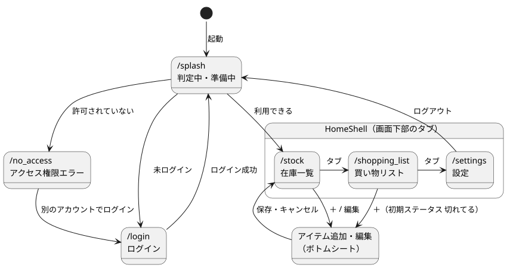
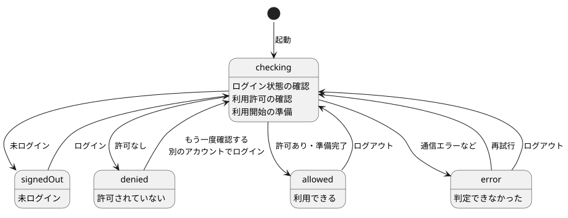

# 画面遷移

実装: `lib/core/router/app_router.dart`, `lib/core/router/home_shell.dart`

## 1. ルート

| パス | 画面（ウィジェット） | 備考 |
|---|---|---|
| `/splash` | `SplashPage` | 判定中・準備中のインジケーター。判定に失敗したら「再試行」「ログアウト」 |
| `/login` | `LoginPage` | |
| `/no_access` | `NoAccessPage` | 表示した時点で自動的にサインアウトする |
| `/stock` | `StockPage` | タブ 1。起動時の `initialLocation` |
| `/shopping_list` | `ShoppingListPage` | タブ 2 |
| `/settings` | `SettingsPage` | タブ 3 |

- タブ 1〜3 は `StatefulShellRoute.indexedStack` でまとめ、`HomeShell` が画面下部の `NavigationBar` を表示する。タブを切り替えても各タブの状態（スクロール位置など）は保たれる。選択中のタブをもう一度押すと、そのタブの最初の画面に戻る。
- 買い物リストのタブには、`shoppingCountProvider` の件数を `Badge` で表示する（0 件のときは非表示）。
- アイテムの追加・編集はルートを持たず、モーダルボトムシート（`showItemEditSheet`）で開く。
- **未実装**: カテゴリ管理画面（`/settings/categories`）、PC 用のサイドナビ（PC でも画面下部のタブを使う）。

元データ: [screen_flow.puml](diagrams/screen_flow.puml)

## 2. 遷移先の決め方

`appRouterProvider` は `accessStatusProvider`（`AccessStatus`）を `ref.listen` で監視し、`ValueNotifier` を通して `GoRouter` の `refreshListenable` に伝える。状態が変わるたびに `redirectFor(状態, 現在地)` が呼ばれ、遷移先が決まる。

元データ: [access_status.puml](diagrams/access_status.puml)

### AccessStatus の決まり方

| 状態 | 条件 |
|---|---|
| `checking` | `accessCheckProvider` の読み込み中（ログイン状態の確認・利用許可の確認・利用開始の準備） |
| `signedOut` | 未ログイン |
| `denied` | ログインしたが、利用を許可されていないアカウント |
| `allowed` | 利用許可の確認と準備（メンバー登録・初期カテゴリ作成）が終わった |
| `error` | 通信エラーなどで判定できなかった |

### redirect の判定表

行 = 状態、列 = 現在地。「―」はそのまま（移動しない）。

| 状態 ＼ 現在地 | `/splash` | `/login` | `/no_access` | タブの画面 |
|---|---|---|---|---|
| `checking` / `error` | ― | `/splash` | ― | `/splash` |
| `signedOut` | `/login` | ― | ― | `/login` |
| `denied` | `/no_access` | `/no_access` | ― | `/no_access` |
| `allowed` | `/stock` | `/stock` | `/stock` | ― |

- `/no_access` は、判定中・未ログインでもそのまま表示し続ける。アクセス権限エラー画面は表示後に自動でサインアウトするため、状態が `denied` → `checking` → `signedOut` と変わっても画面が切り替わらないようにしている。
- `denied` になったとき、`appRouterProvider` がそのときのメールアドレスを `deniedEmailProvider` に入れる（アクセス権限エラー画面に表示するため。URL には入れない）。「別のアカウントでログイン」を押すと、`deniedEmailProvider` を空にして `/login` へ移動する。
- ログイン後は常に `/stock` へ移動する。仕様の「最初に開こうとした画面へ移動する」は**未実装**。

## 3. 主な流れ

| 操作 | 状態の変化 | 画面 |
|---|---|---|
| 起動（ログイン済み・許可あり） | `checking` → `allowed` | `/stock` → `/splash` → `/stock` |
| 起動（未ログイン） | `checking` → `signedOut` | `/splash` → `/login` |
| ログイン（許可あり） | `signedOut` → `checking` → `allowed` | `/login` → `/splash` → `/stock` |
| ログイン（許可なし） | `signedOut` → `checking` → `denied` → `checking` → `signedOut` | `/login` → `/splash` → `/no_access`（以後そのまま） |
| ログアウト（設定画面） | `allowed` → `checking` → `signedOut` | `/settings` → `/splash` → `/login` |
| 判定に失敗 | `checking` → `error` | `/splash`（「再試行」で `accessCheckProvider` を作り直す） |

ログインの処理の流れは [sequences/login.md](../sequences/login.md) を参照。
