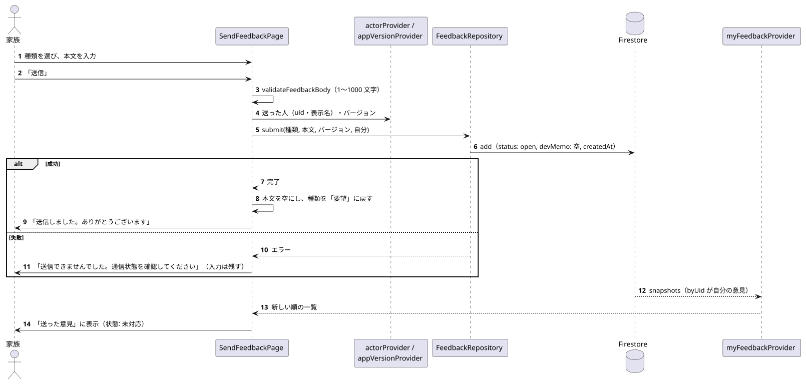
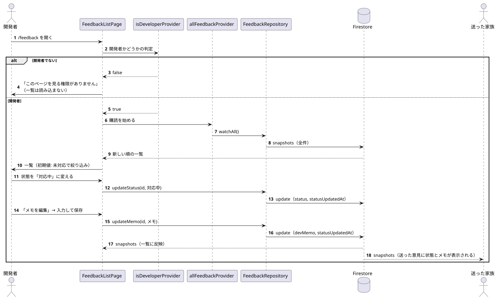

# 改善意見（送信・開発者による管理）

関係するもの: `SendFeedbackPage`, `FeedbackListPage`, `FeedbackRepository`, `myFeedbackProvider`, `allFeedbackProvider`, `isDeveloperProvider`

データの書き込みの詳細は [data/firestore_model.md](../data/firestore_model.md) の「7. 改善意見」を参照。

## 1. 改善意見の送信

元データ: [feedback_submit.puml](diagrams/feedback_submit.puml)

1. 設定画面の「改善意見を送る」から `/settings/feedback` を開き、種類（不具合 / 要望 / その他）と本文を入力する。
2. 「送信」で本文をチェックし（1〜1000 文字）、送った人（`actorProvider`）とアプリのバージョン（`appVersionProvider`。取得できなければ「不明」）を付けて `submit` する。状態は「未対応」、メモは空で保存される。
3. 成功したらフォームを初期状態に戻す。失敗したら入力内容を残してエラーを表示する。
4. 「送った意見」は `myFeedbackProvider`（自分が送った意見だけを購読）なので、送った直後に一覧の先頭に表示される（保存中は日時が「送信中」）。

## 2. 開発者による状態・メモの変更

元データ: [feedback_manage.puml](diagrams/feedback_manage.puml)

1. 開発者が `/feedback` を開くと、まず開発者かどうかを判定する（`isDeveloperProvider`）。開発者でなければ「このページを見る権限がありません」を表示し、一覧は読み込まない。
2. 開発者なら `allFeedbackProvider` で全件を購読し、新しい順に表示する（初期値は「未対応」で絞り込み）。
3. 状態はドロップダウンで選んだ時点で `updateStatus`、メモはダイアログで保存したときに `updateMemo` で保存する。どちらも `statusUpdatedAt` を更新する。
4. 変更はリアルタイムに一覧へ反映され、送った家族の「送った意見」にも状態とメモが表示される。
5. 削除は︙メニューから、確認ダイアログの後に `delete` する（元に戻せない）。
