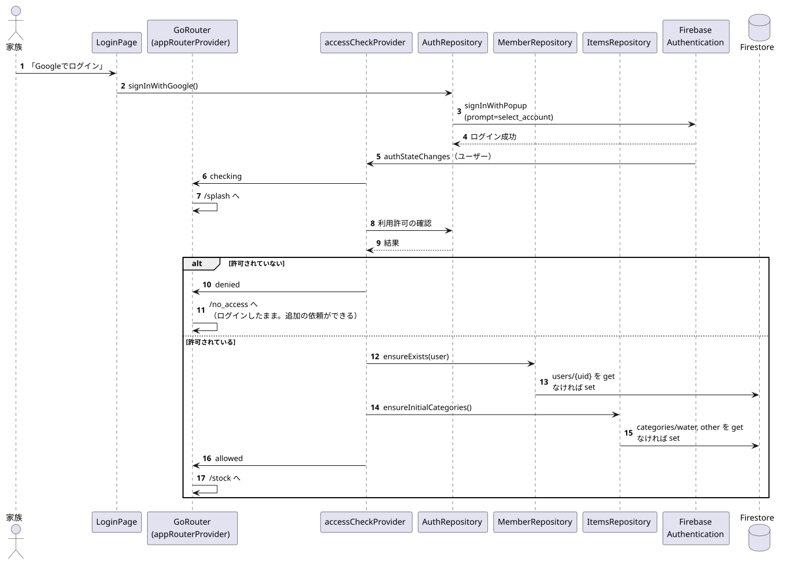

# 起動・ログイン・利用開始の準備

関係するもの: `main.dart`, `appRouterProvider`, `authStateProvider`, `accessCheckProvider`, `AuthRepository`, `MemberRepository`, `ItemsRepository`

## 1. 起動

1. `main.dart` で Firebase を初期化し、Firestore のオフライン永続化を有効にする。
2. `GoRouter` は `/stock` から始まる。最初は判定中（`checking`）なので `/splash` へ移動する。
3. `authStateProvider` が、保存されているログイン状態を流す。
   - 未ログイン → `signedOut` → `/login`。
   - ログイン済み → 下の「利用開始の準備」へ。

## 2. ログイン

元データ: [login.puml](diagrams/login.puml)

1. 「Googleでログイン」で `signInWithPopup` を呼ぶ（アカウント選択を毎回出す `prompt=select_account`）。
2. ログインに成功すると `authStateChanges` が新しいユーザーを流し、`accessCheckProvider` が作り直される（この間は `checking` なので `/splash`）。
3. 利用開始の準備（`accessCheckProvider`）:
   1. 利用許可の確認（`AuthRepository.isAllowed`）。許可されていなければ `denied`。アクセス制限の詳細はリポジトリでは管理しない。
   2. 自分の `users` ドキュメントがなければ作る（`MemberRepository.ensureExists`）。
   3. 初期カテゴリ（`water` / `other`）がなければ作る（`ItemsRepository.ensureInitialCategories`）。
   4. `allowed` を返す → `/stock` へ移動する。
4. 許可されていなかった場合は `/no_access` へ移動し、画面の表示後に自動でサインアウトする（[screens/screen_flow.md](../screens/screen_flow.md)）。

## 3. 失敗したとき

| 場面 | 動き |
|---|---|
| ポップアップを閉じた・別のポップアップと重なった | ログイン画面に「ログインがキャンセルされました」 |
| その他のログインの失敗 | ログイン画面に「ログインできませんでした（エラーコード）」 |
| 利用開始の準備で通信エラー | `error` → スプラッシュ画面に「接続できませんでした」。「再試行」で `accessCheckProvider` を作り直す |

## 4. ログアウト

設定画面で確認のうえ `signOut` → `authStateChanges` が null を流す → `signedOut` → `/login`。`categoriesProvider` / `itemsProvider` は uid が null になると Firestore の購読をやめる。
