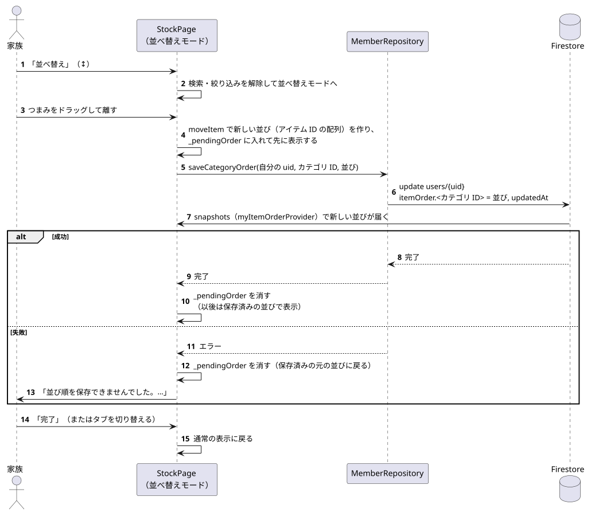

# 並べ替え（自分の並び順の保存）

関係するもの: `StockPage`（並べ替えモード）, `MemberRepository`（`saveCategoryOrder`）, `myItemOrderProvider`, `moveItem` / `sortByMyOrder`（`items/domain/item_order.dart`）

並び順のデータの形は [data/firestore_model.md](../data/firestore_model.md) の「自分の並び順」、画面の構成は [screens/widgets.md](../screens/widgets.md) の在庫一覧を参照。

元データ: [reorder.puml](diagrams/reorder.puml)

1. 「並べ替え」で並べ替えモードに入る（検索・絞り込み中なら解除する）。
2. つまみをドラッグして離すと、`moveItem` が「そのカテゴリに今表示しているアイテムの ID」を新しい順に並べた配列を作る。
3. 保存が終わるまで画面がもとの並びに戻らないよう、配列を `_pendingOrder` に入れて先に表示する。
4. `saveCategoryOrder` が自分の `users` ドキュメントの `itemOrder.<カテゴリ ID>` を丸ごと書き換える。ほかの家族のドキュメントやアイテムには書かないので、ほかの人の画面の並びは変わらない。
5. 保存が終わったら（成功・失敗とも）`_pendingOrder` を消す。成功していれば保存済みの新しい並び、失敗していれば元の並びで表示され、失敗時はエラーを表示する。
6. 「完了」を押すか、ほかのタブに切り替えると通常の表示に戻る。
