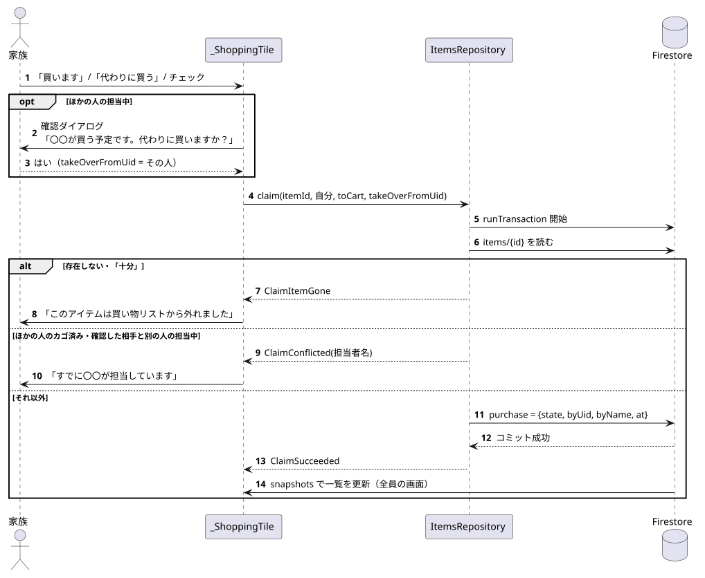
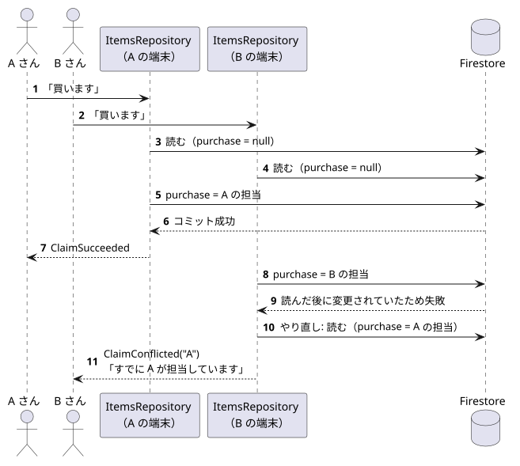
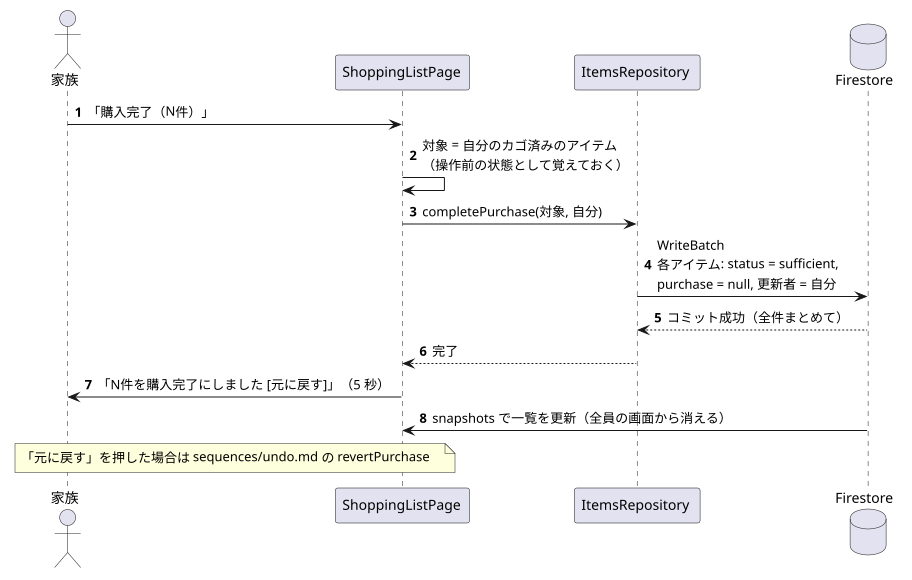

# 買い物（担当宣言・カゴ済み・購入完了）

関係するもの: `ShoppingListPage`（`_ShoppingTile`）, `ItemsRepository`, `ClaimResult`

データの書き込みの詳細は [data/firestore_model.md](../data/firestore_model.md) を参照。

## 1. 担当宣言（「買います」「代わりに買う」・チェック）

元データ: [claim.puml](diagrams/claim.puml)

1. 画面で、そのアイテムがほかの人の担当中なら確認ダイアログ「〇〇が買う予定です。代わりに買いますか？」を出す。OK なら、その人の uid を `takeOverFromUid` として渡す。
2. `ItemsRepository.claim` がトランザクションの中でアイテムを読み直し、結果を返す。

| 結果 | 条件（トランザクションで読んだ時点） | 画面の表示 |
|---|---|---|
| `ClaimSucceeded` | 未担当、自分の担当、または確認した相手の担当中 | なし（一覧がリアルタイムに更新される） |
| `ClaimConflicted` | ほかの人のカゴ済み、または確認した相手と別の人の担当中 | 「すでに〇〇が担当しています」 |
| `ClaimItemGone` | アイテムが削除された、またはステータスが「十分」 | 「このアイテムは買い物リストから外れました」 |
| （例外） | 通信エラーなど | 「保存できませんでした。通信状態を確認してください」 |

### ほぼ同時に 2 人が「買います」を押したとき

元データ: [claim_conflict.puml](diagrams/claim_conflict.puml)

Firestore のトランザクションは、読んだドキュメントがコミットまでに変わっていたら最初からやり直す。後から処理された人のトランザクションは、やり直しの読み取りで先の人の担当を見つけるため、`ClaimConflicted` になって上書きしない。

## 2. カゴ済みのチェック

- チェックを入れる: `claim(toCart: true)`。未担当でも自分が担当者になり、そのままカゴ済みになる。ほかの人の担当中なら、上と同じ確認を出す。
- チェックを外す: `uncheck`。トランザクションで、自分のカゴ済みのときだけ `purchase.state` を `planned` に戻す。
- 「やめる」: `release`。トランザクションで、自分の担当のときだけ `purchase` を null にする。
- ほかの人のカゴ済みは、チェックボックスを押せない。

## 3. 購入完了

元データ: [complete_purchase.puml](diagrams/complete_purchase.puml)

1. 対象は、画面に表示している一覧のうち「自分がカゴ済みにした、残りわずか・切れてるのアイテム」。
2. 確認なしで、`completePurchase` が 1 回のバッチで `status: sufficient`, `purchase: null`, 更新者（自分）を書く。
3. 成功したら「N件を購入完了にしました [元に戻す]」を 5 秒表示する。買い物リストからはリアルタイムに消える。
4. 「元に戻す」を押すと `revertPurchase` で戻す（[undo.md](undo.md)）。
