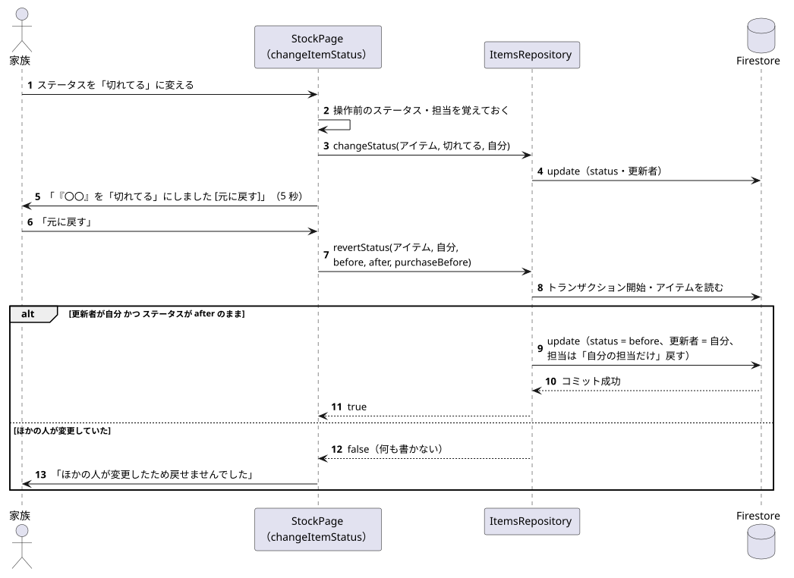

# 元に戻す（ステータス変更・購入完了）

関係するもの: `item_actions.dart`（`changeItemStatus`）, `ShoppingListPage`, `ItemsRepository`（`revertStatus` / `revertPurchase`）, `showUndoMessage`

データの書き込みの詳細は [data/firestore_model.md](../data/firestore_model.md) の「元に戻す」を参照。

## 1. ステータス変更を元に戻す

元データ: [undo.puml](diagrams/undo.puml)

1. ステータスを変える前に、画面側で「操作前のステータス」と「操作前の担当・カゴ済み」を覚えておく。
2. 保存に成功したら、「『〇〇』を「切れてる」にしました [元に戻す]」を 5 秒表示する。
3. 「元に戻す」を押すと、`revertStatus` がトランザクションの中でアイテムを読み直す。

| 読み直した時点の状態 | 結果 | 画面の表示 |
|---|---|---|
| 更新者が自分、かつステータスが自分の設定した値のまま | 操作前のステータスに戻す（更新者は自分） | なし（一覧がリアルタイムに戻る） |
| ほかの人が変更していた（更新者が別の人、またはステータスが違う） | 何も書かない | 「ほかの人が変更したため戻せませんでした」 |
| （例外） | 通信エラーなど | 「元に戻せませんでした。通信状態を確認してください」 |

- 「十分」に変えたときに解除された担当は、自分の担当だけを戻す。ほかの人の担当は解除したままにする（[ADR 0007](../decisions/0007_undo_sets_updater_to_self.md)）。

## 2. 購入完了を元に戻す

1. 購入完了の直前のアイテム（自分のカゴ済み）を覚えておき、「N件を購入完了にしました [元に戻す]」を 5 秒表示する。
2. 「元に戻す」を押すと、`revertPurchase` が 1 つのトランザクションで対象アイテムをすべて読み直す。
3. 「更新者が自分・ステータスが『十分』・担当なし」のままのアイテムだけを、操作前のステータスと自分のカゴ済み（`at` も操作前の値）に戻し、戻せた件数を返す。

| 戻せた件数 | 画面の表示 |
|---|---|
| 全件 | なし |
| 0 件 | 「ほかの人が変更したため戻せませんでした」 |
| 一部 | 「ほかの人が変更したため、N件は戻せませんでした」 |
