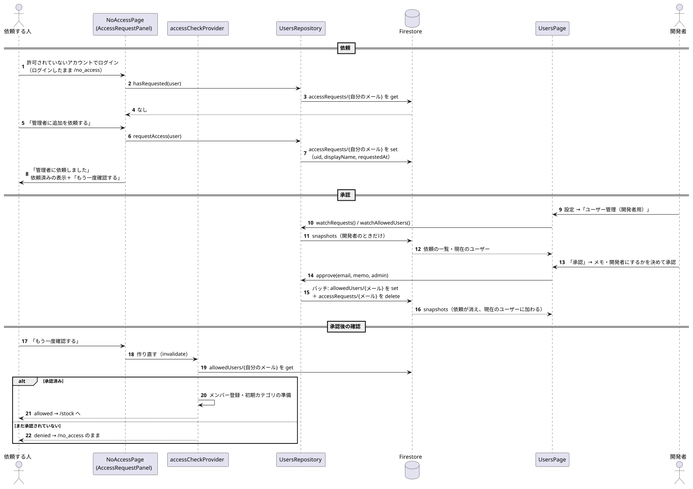

# 追加の依頼とユーザー管理

関係するもの: `NoAccessPage`, `AccessRequestPanel`, `UsersPage`, `UsersRepository`, `myAccessRequestProvider`, `accessRequestsProvider`, `allowedUsersProvider`, `accessCheckProvider`, `isDeveloperProvider`

データの書き込みの詳細は [data/firestore_model.md](../data/firestore_model.md) の「8. 追加の依頼とユーザー管理」、設計の判断は [ADR 0010](../decisions/0010_user_request_in_app.md) を参照。

元データ: [user_request.puml](diagrams/user_request.puml)

## 1. 管理者への追加の依頼

1. 利用を許可されていないアカウントでログインすると、`accessCheckProvider` が `denied` になり `/no_access` へ移動する（[login.md](login.md)）。この画面ではサインアウトせず、ログインしたままにする。
2. `AccessRequestPanel` が `myAccessRequestProvider`（`hasRequested`）で、自分の依頼がすでにあるかを確認する。
3. 依頼がなければ「管理者に追加を依頼する」を表示する。押すと `requestAccess` で `accessRequests/{自分のメールアドレス}` を作り、`myAccessRequestProvider` を作り直す → 「依頼済み」の表示に変わる。
4. 「別のアカウントでログイン」を押したときだけサインアウトして `/login` へ移動する。

## 2. 開発者による承認・却下

1. 開発者が設定画面の「ユーザー管理（開発者用）」から `/users` を開く。開発者かどうかは `isDeveloperProvider` でページの中で判定し、開発者でなければ「このページを見る権限がありません」を表示して一覧は読み込まない。
2. 開発者なら `accessRequestsProvider`（依頼の一覧・古い順）と `allowedUsersProvider`（許可済みの一覧）を購読する。新しい依頼はリアルタイムに表示される。
3. 「承認」で承認ダイアログを開き、メモ（初期値は依頼したアカウントの名前）と「開発者にする」を決める。「承認」で `approve` を呼び、`allowedUsers` への追加と依頼の削除を 1 回のバッチで行う。
4. 「却下」は確認ダイアログの後に `reject` で依頼を削除する。依頼したアカウントは、もう一度依頼できる。

## 3. 承認後の確認

1. 依頼したアカウントの画面には「管理者に追加を依頼済みです」と「もう一度確認する」が表示されている。
2. 「もう一度確認する」で `accessCheckProvider` と `myAccessRequestProvider` を作り直す。状態は `denied` → `checking` → 判定結果、と変わるが、`/no_access` は判定中も表示し続ける（[screens/screen_flow.md](../screens/screen_flow.md)）。
3. 承認されていれば `allowed` になり、利用開始の準備（メンバー登録・初期カテゴリ）の後、`/stock` へ移動する。まだなら `denied` のまま、同じ画面に留まる。却下されていた場合は、依頼ボタンが再び表示される。
4. アプリを閉じて開き直した場合も、ログインしたままなので起動時の判定で同じように切り替わる。

## 4. 失敗したとき

| 場面 | 動き |
|---|---|
| 依頼の保存に失敗（通信エラー・すでに依頼がある） | 「依頼できませんでした。通信状態を確認してください」 |
| 依頼があるかを確認できなかった | 依頼ボタンを表示する（すでに依頼済みなら保存がルールで拒否される） |
| 承認・却下の保存に失敗 | 「保存できませんでした。通信状態を確認してください」。承認はバッチなので、追加だけ・削除だけが反映されることはない |
