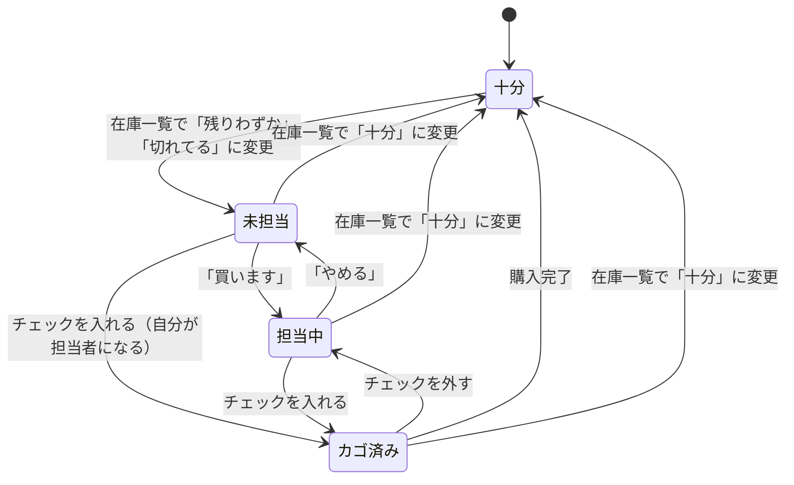

# データ構造（Firestore）

## 1. 共通ルール

- ドキュメントの ID は Firestore のドキュメント ID を使い、`id` フィールドとしては保存しない（例外: 初期カテゴリは固定 ID）。
- 日時はすべて Firestore のタイムスタンプ（サーバー時刻）で保存する。
- 更新者は、ユーザー ID（`uid`）と、その時点の表示名の両方を保存する。表示名は画面にそのまま出すためのもので、あとから表示名を変えても過去の記録は書き換えない。
- メールアドレスは `users` / `categories` / `items` には保存しない。

---

## 2. `users` コレクション（家族メンバー）

ドキュメント ID: Firebase Authentication の `uid`

| フィールド | 型 | 必須 | 説明 |
|---|---|---|---|
| `displayName` | 文字列 | ○ | 表示名（1〜20文字）。初回ログイン時は Google アカウントの名前を入れ、設定画面で変更できる。 |
| `itemOrder` | マップ | − | 自分の並び順（下記）。並べ替えたことがなければ持たない |
| `createdAt` | タイムスタンプ | ○ | 初回ログイン日時 |
| `updatedAt` | タイムスタンプ | ○ | 最終更新日時 |

- 初回ログイン時に、自分のドキュメントがなければ作成する。

### `itemOrder`（自分の並び順）

- キー: カテゴリのドキュメント ID
- 値: そのカテゴリのアイテムのドキュメント ID を、表示する順に並べた配列

```
itemOrder: {
  "water": ["itemA", "itemC", "itemB"],
  "other": ["itemD"]
}
```

- 並べ替えたカテゴリの配列だけを、並べ替えのたびに丸ごと書き換える（そのカテゴリに今あるアイテムだけを入れ、削除済み・移動済みのアイテムは取り除く）。
- 並べ替えても `updatedAt` 以外の項目や、アイテム側の更新者・更新日時は変わらない。
- 表示するときの決まり:
  1. 配列に入っているアイテムを、配列の順に並べる。
  2. 配列に入っていないアイテム（新しく追加した、ほかのカテゴリから移ってきた、まだ並べ替えていないなど）は、その後ろに追加した順（`createdAt` の古い順）で並べる。
  3. 配列に入っているが、存在しない・ほかのカテゴリに移ったアイテムは無視する。
- ほかの家族の `itemOrder` は画面で使わない（読み取りはできてよい）。

---

## 3. `categories` コレクション

ドキュメント ID: 自動採番（初期カテゴリのみ固定 ID）

| フィールド | 型 | 必須 | 説明 |
|---|---|---|---|
| `name` | 文字列 | ○ | カテゴリ名（1〜20文字。ほかのカテゴリと同じ名前は不可） |
| `order` | 数値 | ○ | 表示順（小さいほど上） |
| `createdAt` | タイムスタンプ | ○ | 作成日時 |
| `updatedAt` | タイムスタンプ | ○ | 最終更新日時 |

### 初期カテゴリ

| ドキュメント ID | `name` | `order` | 備考 |
|---|---|---|---|
| `water` | 水回り | 1 | |
| `other` | その他 | 9999 | **削除不可**。常に一番下に表示する。カテゴリ削除時のアイテムの移動先。 |

- ログイン後、初期カテゴリのドキュメントがなければ作成する。ID を固定しているため、複数人が同時に初回ログインしても重複しない。
- 「その他」は名前の変更はできるが、削除・並べ替えはできない。
- カテゴリを削除して「その他」に移ったアイテムは、各自の並び順では「その他」の末尾（未設定）になる。
- 追加したカテゴリの `order` は、「その他」を除いた既存カテゴリの最大値 + 1 とする。

---

## 4. `items` コレクション

ドキュメント ID: 自動採番

| フィールド | 型 | 必須 | 説明 |
|---|---|---|---|
| `name` | 文字列 | ○ | アイテム名（1〜50文字。ほかのアイテムと同じ名前は不可） |
| `categoryId` | 文字列 | ○ | 所属するカテゴリのドキュメント ID |
| `status` | 文字列 | ○ | `sufficient` / `low` / `empty` |
| `memo` | 文字列 | − | メモ（0〜200文字。例: 「銘柄は〇〇」「詰め替え用」） |
| `purchase` | マップ または null | − | 買い物の状況（下記）。買い物リストに出ていて、誰も担当していなければ null |
| `createdAt` | タイムスタンプ | ○ | 作成日時 |
| `updatedAt` | タイムスタンプ | ○ | 最終更新日時 |
| `updatedByUid` | 文字列 | ○ | 最後に更新した人の `uid` |
| `updatedByName` | 文字列 | ○ | 最後に更新した人の、その時点の表示名 |

### `purchase`（買い物の状況）

| フィールド | 型 | 説明 |
|---|---|---|
| `state` | 文字列 | `planned` = 担当中（買います）/ `in_cart` = カゴ済み |
| `byUid` | 文字列 | 担当者の `uid` |
| `byName` | 文字列 | 担当者の、その時点の表示名 |
| `at` | タイムスタンプ | 担当・カゴ済みにした日時 |

### 状態の決まり

- `status` が `sufficient` のとき、`purchase` は必ず null にする（在庫一覧で「十分」に戻した場合も、担当・カゴ済みを解除する）。
- `status` が `low` ⇄ `empty` で変わっても、`purchase` はそのまま残す。
- `purchase` を変更しても、`updatedAt` / `updatedByUid` / `updatedByName` は更新しない（これらは「在庫情報を最後に更新した人・日時」を表すため）。

### 名前の重複チェック

- アイテム名・カテゴリ名の重複チェックでは、前後の空白を除き、英字の大文字・小文字、全角・半角、ひらがな・カタカナを区別しない。

---

## 5. 状態の移り変わり



| 状態 | `status` | `purchase` |
|---|---|---|
| 十分 | `sufficient` | null |
| 未担当 | `low` / `empty` | null |
| 担当中 | `low` / `empty` | `state` = `planned` |
| カゴ済み | `low` / `empty` | `state` = `in_cart` |

- 未担当のアイテムにいきなりチェックを入れた場合は、自分が担当者になり、そのまま `in_cart` になる。
- `in_cart` のチェックを外すと `planned` に戻る（担当は自分のまま）。
